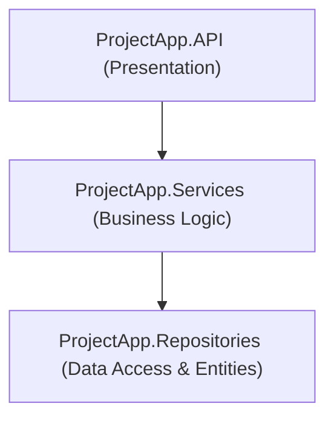
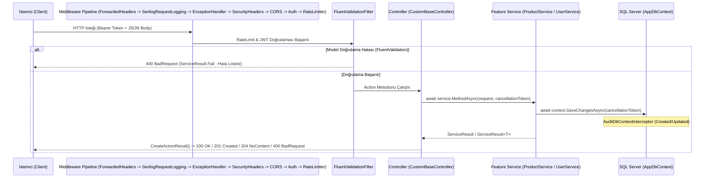

# 🏛️ ProjectApp — .NET 10 N-Tier Mimari Rehberi ve AI Kurallar Anayasası (Architecture Blueprint & AI Guardrails)

> [!NOTE]
> ### 🏷️ Seviye
> Bu şablon **S1 (Vitrin)** seviyesindedir: tek/az admin, anonim ziyaretçi, örnek katalog modülü. Kullanıcı oturumları (S2) ve denetim/soft delete/eşzamanlılık (S3) [`recipes/`](recipes/README.md) klasöründeki reçetelerle eklenir. Kodda olmayan bir özelliği 'en iyi uygulama' diye ekleme; önce seviyeyi ve reçeteyi kontrol et. Ayrıntılar: [`recipes/README.md`](recipes/README.md).

Bu belge, **ProjectApp** çözümünde çalışan **Kıdemli Yazılımcılar (Senior Developers)** ve **Yapay Zeka Kodlama Ajanları (AI Coding Agents — Antigravity, Claude Code, Cursor, Roo Code, GitHub Copilot, Windsurf vb.)** için hazırlanmış **resmi mimari anayasa ve geliştirme rehberidir**. Projede yapılacak her türlü yeni geliştirme, hata düzeltme ve refactoring işlemi bu belgedeki kurallara **%100 sadık kalmak zorundadır**.

> [!IMPORTANT]
> ### 📚 Yapay Zeka Ajanları İçin Zorunlu Doküman Okuma Sırası (AI Reading Order)
> Projede herhangi bir işlem yapmadan önce aşağıdaki ana dokümanları **bu sırayla** okuyun:
> 1. **Mimari Anayasa (Şu anki belge):** [`README.md`](./README.md) — Katman kuralları, yasaklı paketler, `Feature-Service` & `ServiceResult<T>` standartları ve yeni özellik ekleme adımları.
> 2. **AI Geliştirme İş Akışı:** [`docs/AI_WORKFLOW.md`](./docs/AI_WORKFLOW.md) — Kod inceleme (Code Review), mantık hatası analizi, plan modu, doğrulama ve Türkçe commit disiplini.
> 3. **Reçeteler:** [`recipes/README.md`](./recipes/README.md) — Seviye atlama (S1→S2, S2→S3) ve opsiyonel kalıp yönergeleri.
>
> SYSTEM_AUDIT ve wiki (docs/wiki) S3 reçetesiyle gelir.

---

## 1. 🤖 AI Ajanları İçin Kesin Sistem Kuralları (AI Agent Guardrails & System Rules)

> [!CAUTION]
> Bu projede kod üreten hiçbir yapay zeka ajanı veya geliştirici aşağıdaki **5 Temel Sistem Kuralını** ihlal edemez.

### 1.1. 🚫 Yasaklı Paketler (Bloat Koruması)
Aşağıdaki NuGet paketleri bu çözüme **kesinlikle eklenemez** (önerilemez, `.csproj` dosyalarına dahil edilemez):
- ❌ **`AutoMapper`** (Yalnızca **Mapster** kullanılır)
- ❌ **`MediatR` / `MediatR.Contracts`** (CQRS/Mediator deseni kullanılmaz; doğrudan **Feature-Service** deseni kullanılır)
- ❌ **`Swashbuckle.AspNetCore`** (Yalnızca yerleşik **`Microsoft.AspNetCore.OpenApi`** + **`Scalar.AspNetCore`** kullanılır)
- ❌ **`MassTransit`** (N-Tier mimaride varsayılan dışı ağır mesajlaşma paketleri eklenmez)
- ❌ **`Finbuckle.MultiTenant`**, **`Ardalis.Specification`**
- ❌ **`FluentValidation.AspNetCore`** (kullanımdan kaldırıldı; yalnızca `FluentValidation.DependencyInjectionExtensions` + `FluentValidationFilter`)
- ❌ **`FluentAssertions`** (v8 ticari lisans; testlerde xUnit `Assert` kullanılır)

### 1.2. 🎯 Zorunlu İş Mantığı Deseni (`Feature-Service` & `ServiceResult<T>`)
- İş mantığı `ProjectApp.Services/Features/<FeatureName>/` altında **`I<Entity>Service`** arayüzü ve **`<Entity>Service`** sınıfı ile yazılır.
- **Tüm servis metotları** dönüş tipi olarak `Task<ServiceResult<T>>` veya `Task<ServiceResult>` dönmek **zorundadır**.
- **İstisna Fırlatma Yasağı:** İş kuralları veya validasyon hataları için servis katmanında **asla** `throw new Exception(...)` veya özel iş istisnası fırlatılmaz! Bunun yerine uygun HTTP durum koduyla `ServiceResult.Fail("Hata mesajı", HttpStatusCode.BadRequest)` veya `ServiceResult<T>.Fail("Kayıt bulunamadı", HttpStatusCode.NotFound)` dönülür.

### 1.3. 🎮 Controller Tasarım Kuralı (`CustomBaseController`)
- Tüm API Controller sınıfları `ProjectApp.API.Controllers.CustomBaseController` sınıfından miras alır.
- Controller metotları iş mantığı içermez ve yanıtları **tek satırda** `CreateActionResult` yardımcı metodu ile döner:
  ```csharp
  [HttpPost]
  public async Task<IActionResult> Create(CreateProductRequest request) =>
      CreateActionResult(await productService.CreateAsync(request));
  ```
- Controller uç noktaları dışarıdan **asla doğrudan `Entity` kabul etmez** ve istemciye **asla doğrudan `Entity` dönmez** (yalnızca `Request` ve `Response`/`Dto` record tipleri kullanılır).

### 1.4. 🆔 Kimlik (ID) Standardı (`Guid.CreateVersion7()`)
- Tüm Entity sınıfları (`BaseEntity<Guid>`), DTO'lar, Request/Response modelleri ve Route parametreleri (`{id:guid}`) **`Guid`** tipindedir (`int` ID kullanılmaz).
- Yeni kayıtlarda zaman damgalı **`Guid.CreateVersion7()`** kullanılır (`BaseEntity` kurucusunda atanır).
- **Not:** SQL Server `uniqueidentifier` değerlerini son byte'lardan başlayarak sıraladığı için Guid v7 SQL Server'da kronolojik **sıralanmaz**. Kronolojik sıralama gereken yerlerde (ör. sayfalama) `OrderBy(x => x.Created).ThenBy(x => x.Id)` kullanılır.

### 1.5. 🔄 Nesne Eşleme (Mapping) Kuralı (`Mapster`)
- Yalnızca **`Mapster` (`10.x`)** ve **`Mapster.DependencyInjection` (`10.x`)** kullanılır.
- Servis sınıflarına `MapsterMapper.IMapper` enjekte edilir (`mapper.Map<TDestination>(source)`).
- Özel eşleme kuralları her Feature klasörü içinde `IRegister` arayüzünü uygulayan sınıflarla (`ProductMappingConfig : IRegister`) tanımlanır; `ServiceExtensions.cs` başlangıçta `TypeAdapterConfig.GlobalSettings.Scan(typeof(ServiceAssembly).Assembly)` ile tüm profilleri otomatik tarar.

---

## 2. 🏛️ Mimari Yapı, Katmanlar ve Bağımlılık İlişkileri (Architecture & Dependency Flow)

### 2.1. Çözüm Ağacı (Solution Tree)

```text
ProjectApp.slnx
├── README.md                                # [1. Mimari Anayasa ve AI Kuralları]
├── AGENTS.md                                # Kısa ajan kuralları özeti
├── .editorconfig                            # Kod analizi tercihleri (template 0 uyarıyla derlenir)
├── global.json                              # .NET SDK 10 sürüm sabitlemesi + test runner: Microsoft.Testing.Platform (xunit v4)
├── docs/                                    # [AI İş Akışı Klasörü]
│   └── AI_WORKFLOW.md                       # [2. AI Geliştirme İş Akışı, Code Review, Planlama & Commit Kuralları]
│
├── recipes/                                 # [Seviye Atlama ve Opsiyonel Reçeteler]
│   ├── README.md                            # [3. Reçete İndeksi ve Seviye Kılavuzu]
│   ├── S1-S2/                               # S1 → S2: Kullanıcı oturumları, refresh token, logout, şifre sıfırlama
│   ├── S2-S3/                               # S2 → S3: Denetim alanları, soft delete, RowVersion/409, wiki + SYSTEM_AUDIT
│   └── opsiyonel-generic-repository-dapper/ # Generic repository, UnitOfWork, Dapper referansı
│
├── ProjectApp.API/                          # [Sunum Katmanı - Startup Project]
│   ├── Controllers/
│   │   ├── CustomBaseController.cs          # ServiceResult -> IActionResult dönüşüm merkezi
│   │   ├── AuthController.cs                # /api/auth/* (Login, Me)
│   │   ├── UsersController.cs               # /api/users/* (ChangePassword)
│   │   ├── ProductsController.cs            # /api/products/* (GetAll, GetPaged, GetById, Create, Update, Delete)
│   │   └── CategoriesController.cs          # /api/categories/* (GetAll, GetById, Products, Create, Update, Delete)
│   ├── ExceptionHandlers/
│   │   ├── CriticalExceptionHandler.cs      # IExceptionHandler (Öncelik 1): CriticalException'ı Critical seviyesinde loglar
│   │   └── GlobalExceptionHandler.cs        # IExceptionHandler (Öncelik 2): 499 (iptal), 409 (unique), güvenli 500
│   ├── Extensions/
│   │   ├── AuthenticationExtensions.cs      # IdentityCore, Password/Lockout kuralları, JWT Bearer ve OnTokenValidated (security stamp)
│   │   ├── ControllerExtensions.cs          # AddControllers + FluentValidationFilter kaydı
│   │   ├── CorsExtensions.cs                # Development & Production CORS politikaları
│   │   ├── ExceptionHandlerExtensions.cs    # IExceptionHandler zinciri kaydı
│   │   ├── ForwardedHeadersExtensions.cs    # X-Forwarded-* (KnownProxies / KnownNetworks / NoProxy) kontrolü
│   │   ├── HealthCheckExtensions.cs         # /health (liveness) ve /health/ready (SQL kontrolü)
│   │   ├── OpenApiExtensions.cs             # OpenAPI v1 şeması + Scalar UI (/scalar/v1) + JWT Bearer şeması
│   │   ├── RateLimiterExtensions.cs         # Tek global FixedWindow (NameIdentifier/IP) limiter
│   │   ├── SecurityHeadersExtensions.cs     # nosniff, X-Frame-Options, Referrer-Policy, Permissions-Policy, CSP
│   │   └── SerilogExtensions.cs             # Serilog yapılandırması (Console + günlük dönen dosya)
│   ├── Filters/
│   │   └── FluentValidationFilter.cs        # IAsyncActionFilter: doğrulama hatalarını ServiceResult.Fail olarak döner
│   ├── Infrastructure/
│   │   ├── IdentityDataSeeder.cs            # Development: MigrateAsync + Seed:AdminPassword ile admin (roller migration'dan gelir)
│   │   └── OpenApi/BearerSecuritySchemeTransformer.cs # Bearer şeması + yalnız [Authorize] uçlara güvenlik gereksinimi
│   ├── Services/
│   │   └── CurrentUser.cs                   # ICurrentUserService implementasyonu (HttpContext.User claims okuyucu)
│   ├── Program.cs                           # DI kayıtları ve HTTP Middleware Pipeline sıralaması
│   ├── ProjectApp.API.http                  # Hazır HTTP istekleri (auth, katalog, kullanıcı, health)
│   ├── appsettings.json                     # Bağlantı cümlesi (DefaultConnection → ProjectAppDb), JWT, RateLimiting (CORS listesi boş)
│   ├── appsettings.Development.json         # Geliştirme: localhost CORS kaynakları, proje başına üretilen SigningKey, Seed:AdminPassword
│   └── appsettings.Production.json          # Canlı ortam şablonu (ortam değişkenleri ile ezilecek anahtarlar)
│
├── ProjectApp.Services/                     # [İş Mantığı Katmanı - Business / Service Layer]
│   ├── Common/
│   │   ├── Email/                           # IEmailService, LoggingEmailService (varsayılan: loglama)
│   │   ├── Pagination/                      # PagedRequest, PagedResult<T>, IQueryable.ToPagedResultAsync()
│   │   └── Validation/                      # PasswordRules.StrongPassword() (tek kaynak şifre kuralı)
│   ├── ExceptionHandlers/
│   │   └── CriticalException.cs             # Acil müdahale gerektiren hatalar için istisna türü
│   ├── Extensions/
│   │   └── ServiceExtensions.cs             # Mapster, FluentValidation, Options, e-posta ve Feature-Service DI kayıtları
│   ├── Features/
│   │   ├── Auth/                            # IAuthService, AuthService, LoginRequest, TokenResponse, CurrentUserResponse
│   │   ├── Users/                           # IUserService, UserService, ChangePasswordRequest
│   │   ├── Categories/                      # ICategoryService, CategoryService, Create/Update/Dto/Mapping/Validators
│   │   └── Products/                        # IProductService, ProductService, Create/Update/ProductDto/Mapping/Validators
│   ├── Identity/
│   │   ├── ITokenService.cs & TokenService.cs # AccessToken (JWT + security_stamp) üretimi
│   │   └── JwtOptions.cs                    # Options pattern (DataAnnotations doğrulamalı)
│   └── ServiceResult.cs                     # ServiceResult ve ServiceResult<T> sarmalayıcı sınıfları
│
├── ProjectApp.Repositories/                 # [Veri Erişim Katmanı - Data Access Layer]
│   ├── Common/                              # BaseEntity, AuditableEntity (Created/Updated), ICurrentUserService
│   ├── Context/
│   │   └── AppDbContext.cs                  # IdentityDbContext<AppUser, AppRole, Guid>
│   ├── Extensions/
│   │   └── RepositoryExtensions.cs          # DbContext ve AuditDbContextInterceptor DI kayıtları
│   ├── Categories/                          # Category, CategoryConfiguration (unique index)
│   ├── Products/                            # Product, ProductConfiguration (unique index)
│   ├── Identity/
│   │   ├── AppUser.cs                       # IdentityUser<Guid>
│   │   ├── AppRole.cs                       # IdentityRole<Guid>
│   │   ├── RoleNames.cs                     # Admin / User sabitleri
│   │   ├── AppRoleConfiguration.cs          # Admin/User rolleri HasData ile migration'a gömülü
│   │   ├── TurkishIdentityErrorDescriber.cs # Identity hata mesajlarının Türkçe karşılıkları
│   │   └── AppUserConfiguration.cs          # AppUser EF Core konfigürasyonu
│   ├── Interceptors/
│   │   └── AuditDbContextInterceptor.cs     # SaveChangesInterceptor: Otomatik Created/Updated zaman damgası ataması
│   └── Migrations/                          # InitialCreate (şema + roller) ve model anlık görüntüsü (Snapshot)
│
└── tests/                                   # [Test Projeleri - xUnit v3]
    ├── ProjectApp.UnitTests/                # Validator + servis testleri (SQLite TestDb + NSubstitute)
    └── ProjectApp.IntegrationTests/         # WebApplicationFactory + SQLite in-memory (Auth, Catalog, Security)
```

### 2.2. Katman Bağımlılık Akışı ve Sınır Kuralları



| Katman | Referans Verdiği Proje | Sorumluluklar ve Kesin Sınır Kuralları |
| :--- | :--- | :--- |
| **`ProjectApp.Repositories`** | *Yok (En alt katman)* | `AppDbContext`, Entity'ler (`Product`, `Category`, `AppUser`, `AppRole`), `IEntityTypeConfiguration<T>` ve `AuditDbContextInterceptor` barındırır. **Bu katmana asla DTO, iş kuralı veya Controller referansı eklenmez.** (Generic repository ve UnitOfWork opsiyonel reçeteyle gelir). |
| **`ProjectApp.Services`** | `ProjectApp.Repositories` | İş mantığı (`Feature-Service`), DTO/Request/Response modelleri, `FluentValidation` sınıfları, `Mapster` profilleri ve `ServiceResult<T>` barındırır. Servisler `AppDbContext`'i doğrudan kullanır. Hiçbir ASP.NET Core MVC tipine (filter, exception handler) bağımlı değildir. |
| **`ProjectApp.API`** | `ProjectApp.Services` *(ve dolaylı olarak `Repositories`)* | Yalnızca `CustomBaseController` tabanlı Controller'lar, Middleware/Pipeline yapılandırması (`Program.cs`), `CurrentUser` (`HttpContextAccessor`), `FluentValidationFilter`, exception handler'lar, CORS, Rate Limiting, ForwardedHeaders, OpenAPI/Scalar ve `IdentityDataSeeder` içerir. **Controller içinde `AppDbContext` doğrudan enjekte edilmez.** (NotFoundFilter opsiyonel reçeteyle gelir). |

---

## 3. 🛡️ Güvenlik Mimarisi ve Sıkılaştırma Kuralları (Security & Hardening Standards)

### 3.1. JWT & Güvenlik Damgası (Security Stamp) ile Anında İptal
- **Zero ClockSkew:** `AuthenticationExtensions.cs` içinde `ClockSkew = TimeSpan.Zero` olarak ayarlanmıştır; süresi dolan Access Token saniyesinde geçersiz olur.
- **Access Token 120 dk:** Tek/az admin senaryosunda refresh token bulunmaz; access token ömrü varsayılan 120 dakikadır (çalınan token'ın açık kalacağı süre sınırlı, şifre değişince security stamp anında iptal eder).
- **Giriş olayları loglanır:** başarılı giriş (Information), hatalı şifre ve bilinmeyen hesap (Warning). E-posta loga yazılmaz.
- **Refresh token YOK:** Kullanıcı oturumları, RefreshToken ve token rotasyonu S1-S2 reçetesiyle gelir ([`recipes/S1-S2/README.md`](recipes/S1-S2/README.md)).
- **Access token anında iptal edilir (security stamp):** `TokenService` access token'a `security_stamp` claim'i ekler; `AuthenticationExtensions` içindeki `OnTokenValidated` her kimliği doğrulanmış istekte bu değeri veritabanındaki `SecurityStamp` ile karşılaştırır. Kullanıcı silinmişse veya stamp farklıysa istek **401** alır. Şifre değişikliği stamp'i yeniler; eski token'lar süresinin dolmasını beklemeden anında geçersiz olur.
  - **Bedel:** Kimliği doğrulanmış her istekte kullanıcı başına bir indeksli okuma (anonim ziyaretçi istekleri etkilenmez).
- Kullanıcı oturumları, refresh-token ve token iptali S2 reçetesiyle gelir.

### 3.2. Kesin IDOR (Insecure Direct Object Reference) Koruması
- **`UsersController` (`/api/users/*`)** içindeki hiçbir uç nokta dışarıdan **`Guid userId` parametresi ALMAZ**.
- İşlem yapılacak kullanıcı her zaman JWT içindeki `ClaimTypes.NameIdentifier` (`sub`) claim'ini okuyan **`ICurrentUserService.UserId`** üzerinden tespit edilir. Böylece bir kullanıcının başka bir kullanıcının şifresini değiştirmesi mimari düzeyde imkansızdır.
- **Rol tabanlı yetki:** `Products` ve `Categories` okuma uçları herkese açıktır; ekleme/güncelleme/silme uçları `[Authorize(Roles = RoleNames.Admin)]` ile yalnızca `Admin` rolüne açıktır.

### 3.3. ASP.NET Core Identity & Brute-Force Koruması
- **Parola Politikası:** En az 8 karakter, büyük harf, küçük harf, rakam ve alfanümerik olmayan özel karakter zorunludur (`RequireUniqueEmail = true`).
- **Hesap Kilitleme (Account Lockout):** `MaxFailedAccessAttempts = 5` ve `DefaultLockoutTimeSpan = TimeSpan.FromMinutes(15)` aktiftir.
- **Kilitli girişte tek tip yanıt:** Kilitli hesapla giriş, şifre doğru olsa bile hatalı şifreyle aynı `401 "E-posta veya şifre hatalı."` yanıtını alır (kilit bilgisi istemciye sızdırılmaz, yalnızca loglanır); kilit 15 dakika sonra kendiliğinden kalkar.
- `AuthService.LoginAsync` içinde önce `userManager.IsLockedOutAsync(user)` kontrol edilir; şifre yanlışsa `userManager.AccessFailedAsync(user)` çağrılarak sayaç artırılır, doğruysa `ResetAccessFailedCountAsync(user)` ile sıfırlanır.
- **Şifre değiştirmede de lockout:** `ChangePasswordAsync` içinde mevcut şifre hatalıysa `AccessFailedAsync` sayacı artar; hesap kilitliyse işlem `403` ile reddedilir.
- Kullanıcı kayıt (register), e-posta değişikliği (change-email) ve hesap silme (DeleteAccount) S2/S3 reçetesiyle gelir.

### 3.4. Rate Limiting (Hız Sınırlandırma)
- **Pipeline sırası:** `UseAuthentication()` → `UseRateLimiter()` → `UseAuthorization()`. Limiter kimlik doğrulamadan sonra çalıştığı için kullanıcı bazlı bölümleme mümkündür.
- **Tek Global Limiter:** Kimliği doğrulanmış kullanıcılar için `ClaimTypes.NameIdentifier`, anonim istekler için `Connection.RemoteIpAddress` anahtarıyla bölümlenmiş (Partitioned) `FixedWindowLimiter` (varsayılan: dakikada 60 istek, `RateLimiting:Fixed`) çalışır. 429 yanıtı `ServiceResult` formatında ve `Retry-After` başlığıyla döner.
- Auth uçlarına özel hız sınırlandırma ve ek limiter politikaları S2 reçetesiyle gelir.
- **Reverse proxy:** `ForwardedHeaders` en başta çalışır; gerçek istemci IP'sinin görünmesi için `ForwardedHeaders:KnownProxies` (tek IP) veya `ForwardedHeaders:KnownNetworks` (CIDR) tanımlanabilir. Canlı ortamda ikisi de boşsa uygulama açılır, proxy yok kabul edilir ve açılışta tek bir uyarı loglanır. Proxy'siz dağıtımda `ForwardedHeaders:NoProxy = true` verilerek uyarı kapatılabilir.

### 3.5. CORS, HSTS ve HTTP Güvenlik Başlıkları
- `SecurityHeadersExtensions.cs` her yanıta (exception handler'ın ürettiği 500/409 yanıtları dahil; başlıklar `Response.OnStarting` ile eklenir) şu başlıkları ekler:
  - `X-Content-Type-Options: nosniff`
  - `X-Frame-Options: DENY`
  - `Permissions-Policy: camera=(), microphone=(), geolocation=()`
  - `Referrer-Policy: strict-origin-when-cross-origin`
  - `Content-Security-Policy: default-src 'none'; frame-ancestors 'none'` (Scalar/OpenAPI rotaları hariç)
- Production ortamında `app.UseHsts()`, `app.UseHttpsRedirection()` ve yalnızca `Cors:AllowedOrigins` dizisindeki adreslere izin veren `ProdCorsPolicy` devreye girer.
- **CORS kaynakları:** `Development` ortamında `DevCorsPolicy` tüm kaynaklara izin verir (`AllowAnyOrigin`). Production ortamında `Cors:AllowedOrigins` listesi kullanılır; liste boşsa uygulama açılır, hiçbir kaynağa izin verilmez ve açılışta tek bir uyarı loglanır.
- **Host filtreleme:** Production ortamında `AllowedHosts` `*` kabul edilir; host başlığını kısıtlamak için `AllowedHosts=api.alanadiniz.com` verilmesi önerilir.
- **Production açılış garantisi:** Production ortamında yalnızca `ConnectionStrings:DefaultConnection` veya `Jwt:SigningKey` (en az 32 karakter) eksikse uygulama açılmaz; `ForwardedHeaders` veya `Cors:AllowedOrigins` boşsa uyarı logu yazılır.

### 3.6. Veri Güvenliği: `AuditDbContextInterceptor`
- **`AuditDbContextInterceptor` (`SaveChangesInterceptor`):**
  - **`EntityState.Added`:** `Created = timeProvider.GetUtcNow().UtcDateTime` (`TimeProvider`) atanır; `Updated` alanının `IsModified` özelliği `false` yapılarak korunur.
  - **`EntityState.Modified`:** `Created` alanı `IsModified = false` ile korumaya alınır; `Updated = timeProvider.GetUtcNow().UtcDateTime` atanır.
- Denetim kullanıcı alanları (`CreatedBy`, `UpdatedBy`), soft delete (`IsDeleted`) ve iyimser eşzamanlılık (`RowVersion`) S2/S3 reçetesiyle gelir ([`recipes/S2-S3/README.md`](recipes/S2-S3/README.md)).

---

## 4. 🔄 Standart İstek Yaşam Döngüsü (Request Lifecycle & Pipeline)

Bir HTTP isteğinin `ProjectApp.API` uygulamasına girişinden yanıt olarak çıkışına kadar izlediği tam sıra:



0. **`UseForwardedHeaders()` -> `UseSerilogRequestLogging()`:** Proxy başlıkları işlenir, Serilog istek özetini loglar (istek logu exception handler'ın dışında olduğundan 409/499 yanıtları 500 diye loglanmaz; CorrelationId S3 reçetesiyle gelir).
1. **`UseExceptionHandler()`:** İşlenmeyen bir istisna fırlatılırsa önce `CriticalExceptionHandler`, ardından `GlobalExceptionHandler` devreye girer: istek iptali `499`, unique index ihlali `409`, diğerleri stack-trace sızdırmadan `500` (`ServiceResult.Fail`).
2. **`UseSecurityHeaders()` -> `UseOpenApiAndScalar()` -> `UseHsts()` -> `UseHttpsRedirection()` -> `UseCors()`:** Güvenlik başlıkları, OpenAPI/Scalar, HTTPS ve CORS çalışır.
3. **`UseAuthentication()` -> `UseRateLimiter()` -> `UseAuthorization()`:** JWT doğrulanır (`OnTokenValidated` ile security stamp kontrolü dahil), `HttpContext.User` doldurulur, kullanıcı/IP bazlı hız sınırı uygulanır, ardından yetkilendirme yapılır.
4. **`FluentValidationFilter`:** İstek DTO'su için ilgili `AbstractValidator<T>` çalışır; kural ihlali varsa Controller'a girmeden `400 BadRequest` (`ServiceResult.Fail`) döner. (NotFoundFilter opsiyonel reçeteyle gelir).
5. **`CustomBaseController` -> `Feature-Service` -> `AppDbContext`:** İş mantığı çalışır, `await context.SaveChangesAsync(cancellationToken)` çağrılır (interceptor yalnızca Created/Updated zaman damgası atar) ve `ServiceResult` uygun HTTP durum koduyla istemciye gönderilir. (UnitOfWork ve generic repository opsiyonel reçeteyle gelir).

---

## 5. 🛠️ Adım Adım Yeni Bir "Feature / Entity" Ekleme Rehberi (Step-by-Step Developer & AI Guide)

Projeye örneğin **`Order` (Sipariş)** adında yeni bir modül eklerken aşağıdaki **4 adımlı kontrol listesini** sırasıyla uygulayın:

### ☐ Adım 1: Entity ve EF Core Konfigürasyonu (`ProjectApp.Repositories/Orders/`)
1. `ProjectApp.Repositories/Orders/Order.cs` dosyasını oluşturun (`AuditableEntity`'den türetin; `Created/Updated` zaman damgalarını hazır getirir; soft delete ve RowVersion S2/S3 reçetesiyle gelir):
   ```csharp
   namespace ProjectApp.Repositories.Orders;

   public class Order : AuditableEntity
   {
       public string OrderCode { get; set; } = default!;
       public decimal TotalAmount { get; set; }
   }
   ```
2. `ProjectApp.Repositories/Orders/OrderConfiguration.cs` içinde `IEntityTypeConfiguration<Order>` sınıfını yazın (`OnModelCreating` bunu `ApplyConfigurationsFromAssembly` ile otomatik bulur). Düz unique index kullanın:
   ```csharp
   using Microsoft.EntityFrameworkCore;
   using Microsoft.EntityFrameworkCore.Metadata.Builders;

   namespace ProjectApp.Repositories.Orders;

   public class OrderConfiguration : IEntityTypeConfiguration<Order>
   {
       public void Configure(EntityTypeBuilder<Order> builder)
       {
           builder.HasKey(x => x.Id);
           builder.Property(x => x.OrderCode).IsRequired().HasMaxLength(50);
           builder.HasIndex(x => x.OrderCode).IsUnique();
           builder.Property(x => x.TotalAmount).IsRequired().HasColumnType("decimal(18,2)");
       }
   }
   ```
3. `AppDbContext.cs` içine `public DbSet<Order> Orders { get; set; } = default!;` ekleyin.

### ☐ Adım 2: DTO, Request/Response, Validator ve Mapster (`ProjectApp.Services/Features/Orders/`)
1. `OrderDto.cs`, `Create/CreateOrderRequest.cs`, `Create/CreateOrderResponse.cs`, `Update/UpdateOrderRequest.cs` dosyalarını **`record`** olarak tanımlayın.
2. `Create/CreateOrderRequestValidator.cs` içinde `AbstractValidator<CreateOrderRequest>` kurallarını yazın (`AddValidatorsFromAssembly` otomatik kaydeder).
3. `OrderMappingConfig.cs` içinde `IRegister` uygulayın (`typeAdapterConfig.Scan` otomatik tarar).

### ☐ Adım 3: Feature-Service Arayüzü, Uygulaması ve DI Kaydı (`ProjectApp.Services/Features/Orders/`)
1. `IOrderService.cs` ve `OrderService.cs` oluşturun (`AppDbContext`'i doğrudan enjekte edin, `Guid.CreateVersion7()` ve `ServiceResult<T>` kullanın; generic repository ve UnitOfWork opsiyonel reçeteyle gelir):
   ```csharp
   using System.Net;
   using MapsterMapper;
   using Microsoft.EntityFrameworkCore;
   using ProjectApp.Repositories;
   using ProjectApp.Repositories.Orders;
   using ProjectApp.Services.Features.Orders.Create;

   namespace ProjectApp.Services.Features.Orders;

   public class OrderService(
       AppDbContext context,
       IMapper mapper) : IOrderService
   {
       public async Task<ServiceResult<CreateOrderResponse>> CreateAsync(CreateOrderRequest request, CancellationToken cancellationToken = default)
       {
           var anyOrder = await context.Orders.AnyAsync(x => x.OrderCode == request.OrderCode, cancellationToken);
           if (anyOrder)
           {
               return ServiceResult<CreateOrderResponse>.Fail("Sipariş kodu veritabanında bulunmaktadır.", HttpStatusCode.BadRequest);
           }

           var order = mapper.Map<Order>(request);
           context.Orders.Add(order);
           await context.SaveChangesAsync(cancellationToken);

           return ServiceResult<CreateOrderResponse>.SuccessAsCreated(
               new CreateOrderResponse(order.Id), $"/api/orders/{order.Id}");
       }
   }
   ```
2. `ServiceExtensions.cs` içine `services.AddScoped<IOrderService, OrderService>();` ekleyin.

### ☐ Adım 3b: Test Ekleme (`tests/`)
`tests/ProjectApp.UnitTests/` altına yeni validator ve servis kuralları için birim test (SQLite `TestDb`), `tests/ProjectApp.IntegrationTests/` altına en az bir uç nokta testi ekleyin; `dotnet test ProjectApp.slnx` yeşil olmalıdır.

### ☐ Adım 4: Controller Oluşturma (`ProjectApp.API/Controllers/OrdersController.cs`)
```csharp
using Microsoft.AspNetCore.Authorization;
using Microsoft.AspNetCore.Mvc;
using ProjectApp.Repositories.Identity;
using ProjectApp.Services.Features.Orders;
using ProjectApp.Services.Features.Orders.Create;

namespace ProjectApp.API.Controllers;

[Authorize(Roles = RoleNames.Admin)]
public class OrdersController(IOrderService orderService) : CustomBaseController
{
    [HttpGet("{id:guid}")]
    public async Task<IActionResult> GetById(Guid id, CancellationToken cancellationToken) =>
        CreateActionResult(await orderService.GetByIdAsync(id, cancellationToken));

    [HttpPost]
    public async Task<IActionResult> Create(CreateOrderRequest request, CancellationToken cancellationToken) =>
        CreateActionResult(await orderService.CreateAsync(request, cancellationToken));

    [HttpDelete("{id:guid}")]
    public async Task<IActionResult> Delete(Guid id, CancellationToken cancellationToken) =>
        CreateActionResult(await orderService.DeleteAsync(id, cancellationToken));
}
```

---

## 6. 🔐 Hazır Kimlik ve Kullanıcı Uç Noktaları (Built-in Auth & User Endpoints)

### 6.1. Kimlik Doğrulama Uç Noktaları (`AuthController` — `/api/auth`)

| HTTP Metodu | Uç Nokta (Route) | Yetki | İstek Gövdesi (Request Body) | Açıklama ve Davranış |
| :---: | :--- | :---: | :--- | :--- |
| **`POST`** | `/api/auth/login` | Anonim | `LoginRequest(Email, Password)` | E-posta/şifre doğrular, Brute-Force kilidini kontrol eder, `TokenResponse` döner. |
| **`GET`** | `/api/auth/me` | `[Authorize]` | *Yok* | Oturum açmış kullanıcının temel kimlik ve rol bilgilerini (`CurrentUserResponse`) döner. |

> [!NOTE]
> Kullanıcı kayıt (register), refresh token, logout ve şifre sıfırlama uçları S2 reçetesiyle gelir ([`recipes/S1-S2/README.md`](recipes/S1-S2/README.md)).

### 6.2. Kullanıcı ve Profil Yönetimi Uç Noktaları (`UsersController` — `/api/users`)
> **IDOR Güvenlik Garantisi:** Uç nokta `[Authorize]` korumalıdır ve dışarıdan **asla `Guid userId` parametresi almaz**; yalnızca oturum açmış kullanıcının (`ICurrentUserService.UserId`) kendi hesabı üzerinde işlem yapar.

| HTTP Metodu | Uç Nokta (Route) | Yetki | İstek Gövdesi (Request Body) | Açıklama ve Davranış |
| :---: | :--- | :---: | :--- | :--- |
| **`POST`** | `/api/users/change-password` | `[Authorize]` | `ChangePasswordRequest(CurrentPassword, NewPassword)` | Mevcut şifreyi doğrulayarak şifreyi değiştirir ve `UpdateSecurityStampAsync` çağırarak eski oturumları geçersiz kılar. |

> [!NOTE]
> Profil güncelleme, e-posta değişikliği (change-email) ve hesap silme (DeleteAccount) uçları S2/S3 reçeteleriyle gelir ([`recipes/S1-S2/README.md`](recipes/S1-S2/README.md), [`recipes/S2-S3/README.md`](recipes/S2-S3/README.md)).

### 6.3. Varsayılan Geliştirici Admin Hesabı (`IdentityDataSeeder`)
Uygulama **`Development`** ortamında çalıştırıldığında `IdentityDataSeeder.SeedIdentityDataAsync` otomatik olarak migration'ları uygular (`MigrateAsync`), yönetici hesabını açar (`Admin` ve `User` rolleri `AppRoleConfiguration.HasData` ile migration üzerinden her ortama gelir; seeder yalnızca eksikse ekler):
- **E-Posta:** `admin@admin.com`
- **Kullanıcı Adı:** `admin`
- **Şifre:** `Seed:AdminPassword` yapılandırmasından okunur (`appsettings.Development.json` içinde `Password12*`). **Production'da boş bırakılır; tohumlama yalnızca Development'ta çalışır.**
- **Rol:** `Admin`
- **Şifre unutulursa (her ortamda):** `Seed__AdminPassword=<yeni şifre>` ve `Seed__ResetAdminPassword=true` ortam
  değişkenleriyle uygulamayı **bir kez** başlatın. Admin şifresi sıfırlanır, kilit kalkar, eski token'lar geçersiz olur.
  Ardından iki değişkeni hemen kaldırın (`IdentityDataSeeder.ResetAdminPasswordIfRequestedAsync`).

---

## 7. ⚡ Altyapı Özellikleri (Scalar UI, Sayfalama, Loglama, HealthChecks)

1. **Scalar API Dokümantasyonu (`/scalar/v1`):**
   - `Development` ortamında `/openapi/v1.json` ve modern etkileşimli arayüz olan **`/scalar/v1`** otomatik aktiftir.
   - `/api/auth/login` uç noktasından aldığınız `accessToken` değerini Scalar arayüzündeki **Authentication -> Bearer** kutusuna yapıştırarak `[Authorize]` korumalı tüm uç noktaları test edebilirsiniz.
2. **Veritabanı Seviyesinde Sayfalama (`PagedRequest` & `PagedResult<T>`):**
   - `query.OrderBy(x => x.Created).ThenBy(x => x.Id).ProjectToType<ProductDto>().ToPagedResultAsync(request)` kullanımıyla (tutarlı sayfalama için önce `OrderBy` uygulanır) Mapster projeksiyonu ve `Skip`/`Take` sorguları doğrudan SQL üzerinde çalıştırılır.
3. **Asenkron Akışta `CancellationToken` Standartı:**
   - Controller eylemlerinden servis ve DbContext çağrılarına kadar tüm asenkron metotlar `CancellationToken cancellationToken = default` parametresi taşır. İstemci bağlantıyı kestiğinde uzun süren SQL sorguları anında iptal edilir.
4. **Yapısal Loglama (`Serilog`):**
   - `SerilogExtensions.cs` Serilog'u yapılandırır; `UseSerilogRequestLogging()` istek özetlerini loglar. Konsol ve günlük dönen dosya (`logs/log-.txt`) hedefleri aktiftir. (Korelasyon kimliği S3 reçetesiyle gelir; Dapper opsiyonel reçeteyle gelir).
5. **Sağlık Kontrolleri:**
   - `GET /health` → liveness (uygulama ayakta, bağımlılık kontrol etmez).
   - `GET /health/ready` → readiness (`AddSqlServer` ile SQL Server bağlantısını denetler).

### 7.1. API Yanıt Sözleşmesi
- Tüm yanıtlar `ServiceResult` formatındadır: başarıda `{"data": ...}`, hatada `{"errorMessage": ["..."]}`. Hata yanıtında `data`, başarı yanıtında `errorMessage` alanı yazılmaz.
- **Oluşturma (201):** Gövde `{"data": {"id": "..."}}`, `Location` başlığı kök göreli yoldur (ör. `/api/products/{id}`).
- **Benzersizlik ihlali (409 Conflict):** Benzersizlik kısıtı ihlal edildiğinde `GlobalExceptionHandler` tarafından yakalanır ve `409 Conflict` döner. (İyimser eşzamanlılık ve RowVersion S3 reçetesiyle gelir).
- **Fiyat doğrulaması:** `price` en fazla 16 tam ve 2 ondalık basamak içerebilir (`decimal(18,2)`); taşan veya fazla ondalıklı değerler **400** döner (sessiz yuvarlama veya 500 olmaz).
- **429 Too Many Requests:** `ServiceResult` gövdesiyle ve `Retry-After` (saniye) başlığıyla döner.
- **Geçersiz istek gövdesi** (bozuk JSON, yanlış tip): iç tip adları sızmaması için genel bir 400 mesajı döner; Identity hata mesajları `TurkishIdentityErrorDescriber` ile Türkçedir.
- **Sayfalama:** `pageSize` 1–100, `pageNumber` en fazla 1.000.000 (daha büyük değerlerde boş sayfa). Sıralama `Created`, ardından `Id` iledir.

---

## 8. 🚀 Şablon Kullanımı, Migration ve Canlıya Geçiş (Template Usage, EF Migrations & Production Checklist)

### 8.1. .NET CLI (`dotnet new`) veya Visual Studio ile Yeni Proje Oluşturma
Bu şablon .NET SDK şablon havuzunda `my-ntier` kısa adıyla kayıtlıdır. Çözüm dosyası Visual Studio 2026 (v18.0+; .NET 10 hedefini resmi olarak destekleyen ilk sürüm) ve .NET SDK 10 ile uyumlu XML tabanlı `.slnx` formatındadır.

Terminalden yeni bir proje oluşturmak için:
```powershell
dotnet new my-ntier -n SirketProje -o ./SirketProje
```

> [!NOTE]
> **Proje adı kuralı:** `-n` değeri geçerli bir C# ad alanına dönüştürülür ve hem dosya/klasör adlarında hem kod içinde aynı biçim kullanılır. Örneğin `-n my-shop` → `my_shop.API`, `my_shop.slnx`; `-n Shop.Api` olduğu gibi kalır. Çıktı klasörü (`-o`) verdiğiniz adla oluşturulur.
*Visual Studio içinden:* **Yeni Proje Oluştur (Create a new project)** penceresinde `N-Tier Architecture Template (.NET 10)` şablonunu seçip oluşturabilirsiniz.

> [!TIP]
> **Şablon seçenekleri ve üretimde yapılanlar:**
> - `--skip-restore`: Oluşturduktan sonra `dotnet restore` çalıştırılmaz (varsayılan: restore yapılır).
> - Her yeni projede `launchSettings.json` ve `.http` dosyasındaki HTTP/HTTPS portları rastgele (5000–5999 / 7000–7999) atanır; aynı makinede birden fazla proje çakışmaz.
> - `appsettings.Development.json` içindeki geliştirme `Jwt:SigningKey` değeri her projede farklı üretilir (yalnızca geliştirme içindir; Production'da `Jwt__SigningKey` ortam değişkeni kullanılır).
> - Oluşturma sonunda konsolda sonraki adımlar (migration, çalıştırma, Production ayarları) listelenir.

### 8.2. EF Core Migration Komutları
Çözüm kök dizininde (`ProjectApp.slnx` dosyasının bulunduğu klasörde) terminal açarak aşağıdaki komutları çalıştırabilirsiniz:

```powershell
# 1. Veritabanını hazır şemaya güncellemek için (InitialCreate migration'ı şablona dahil edilmiştir):
dotnet ef database update --project .\ProjectApp.Repositories --startup-project .\ProjectApp.API

# 2. Yeni bir entity/özellik ekledikten sonra yeni migration oluşturmak için:
dotnet ef migrations add YeniMigrationAdi --project .\ProjectApp.Repositories --startup-project .\ProjectApp.API
```
> [!TIP]
> Model değiştiğinde (yeni entity, kolon, index) yeni bir migration üretin; şablondaki `InitialCreate` güncel şemayı ve `Admin`/`User` rollerini içerir.
>
> `Development` ortamında `IdentityDataSeeder` başlangıçta bekleyen migration'ları `MigrateAsync()` çağırarak veritabanına (`ProjectAppDb`) otomatik uygular ve admin kullanıcıyı tohumlar. Roller (`Admin`, `User`) migration'ın parçasıdır; Production'da `dotnet ef database update` ile şema ve roller birlikte kurulur.

### 8.3. Canlıya Geçiş (Production) Kontrol Listesi
Uygulamayı Production ortamına taşırken `appsettings.Production.json` veya Ortam Değişkenleri (Environment Variables) üzerinde şu ayarları mutlaka güncelleyin:
- [ ] **`ConnectionStrings:DefaultConnection` (Zorunlu):** Uygulamanın tek bağlantı dizesidir (EF Core ve `/health/ready` aynı değeri kullanır; Dapper opsiyonel reçeteyle gelir). Ortam değişkeni `ConnectionStrings__DefaultConnection` ile verin; boş veya eksikse uygulama açılmaz.
- [ ] **`Jwt:SigningKey` (Zorunlu):** En az 32 karakterli (256-bit+), yüksek entropili gizli bir anahtar belirleyin (kaynak kodda tutmayın, Secret Manager / Key Vault / Env Var kullanın; boş veya 32 karakterden kısaysa uygulama açılmaz).
- [ ] **`ForwardedHeaders:KnownProxies` / `KnownNetworks` (Önerilir):** Reverse proxy / load balancer IP adreslerini veya CIDR ağlarını ekleyin. Boş bırakılırsa uygulama açılır, proxy yok varsayılır ve açılışta tek bir uyarı loglanır; doğrudan internete açıksa `ForwardedHeaders__NoProxy=true` ile uyarı kapatılabilir.
- [ ] **`AllowedHosts` (Önerilir):** API alan adını verin (`AllowedHosts=api.alanadiniz.com`); Production'da varsayılan `*` kabul edilir ancak host başlığını kısıtlamak için alan adının verilmesi önerilir.
- [ ] **`Cors:AllowedOrigins` (Önerilir):** Canlı Frontend alan adlarınızı (`Cors__AllowedOrigins__0=https://app.alanadiniz.com`) ekleyin; liste boş bırakılırsa uygulama açılır ancak hiçbir kaynağa izin verilmez ve açılışta tek bir uyarı loglanır.
- [ ] **Veritabanı:** `dotnet ef database update` ile şemayı kurun; `Admin`/`User` rolleri migration ile gelir. İlk Admin kullanıcıyı Production'da oluşturun.
- [ ] **`Seed:AdminPassword`:** Production'da **boş** bırakın (tohumlama yalnızca Development'tadır).
- [ ] **`RateLimiting`:** Trafik beklentinize göre `RateLimiting:Fixed:PermitLimit` değerini optimize edin.

### 8.4. Test Çalıştırma
```powershell
dotnet build ProjectApp.slnx
dotnet test ProjectApp.slnx -v q
```
> [!NOTE]
> Testler xUnit v3 paketinin 4.x sürümüyle **Microsoft.Testing.Platform** üzerinde çalışır; bunun için `global.json` içinde `"test": { "runner": "Microsoft.Testing.Platform" }` tanımlıdır. `global.json` çalışma klasöründen okunduğu için `dotnet test` komutunu çözüm kök dizininde çalıştırın (başka bir klasörden çalıştırılırsa "VSTest target is no longer supported" hatası alınır).
Entegrasyon testleri SQL Server gerektirmez; `WebApplicationFactory` + SQLite in-memory kullanır.
