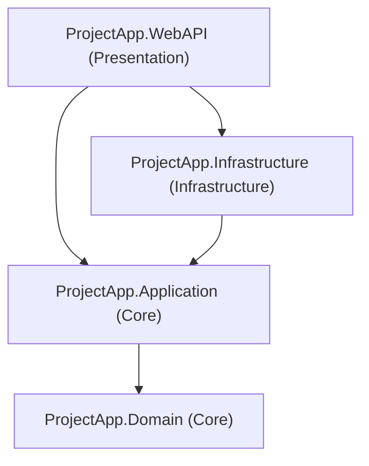
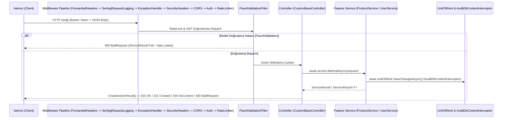

# 🏛️ ProjectApp — .NET 10 Onion / Clean Mimari Rehberi ve AI Kurallar Anayasası (Architecture Blueprint & AI Guardrails)

Bu belge, **ProjectApp** çözümünde çalışan **Kıdemli Yazılımcılar (Senior Developers)** ve **Yapay Zeka Kodlama Ajanları (AI Coding Agents — Antigravity, Claude Code, Cursor, Roo Code, GitHub Copilot, Windsurf vb.)** için hazırlanmış **resmi mimari anayasa ve geliştirme rehberidir**. Projede yapılacak her türlü yeni geliştirme, hata düzeltme ve refactoring işlemi bu belgedeki kurallara **%100 sadık kalmak zorundadır**.

> [!NOTE]
> ### 🏷️ Seviye
> Bu şablon **S3 (Kurum içi)** seviyesindedir. Domain event ve API versiyonlama (S4), önbellek (S5) [`recipes/`](recipes/README.md) reçeteleriyle eklenir. S1-S2 projeleri için `my-ntier` kullanılır. Kodda olmayan bir özelliği 'en iyi uygulama' diye ekleme. Ayrıntılar için [`recipes/README.md`](recipes/README.md) rehberine bakın.

> [!IMPORTANT]
> ### 📚 Yapay Zeka Ajanları İçin Zorunlu Doküman Okuma Sırası (AI Reading Order)
> Projede herhangi bir işlem yapmadan önce aşağıdaki ana dokümanları ve canlı proje indeksini **bu sırayla** okuyun:
> 1. **Mimari Anayasa (Şu anki belge):** [`README.md`](./README.md) — 4 projeli Onion sınır kuralları, yasaklı paketler, `Feature-Service` & `ServiceResult<T>` standartları ve yeni özellik ekleme adımları.
> 2. **AI Geliştirme İş Akışı ve Wiki Kuralları:** [`docs/AI_WORKFLOW.md`](./docs/AI_WORKFLOW.md) — Proje Wiki sistemi ([`docs/wiki/index.md`](./docs/wiki/index.md) & [`docs/wiki/log.md`](./docs/wiki/log.md)), kod inceleme (Code Review), mantık hatası analizi, plan modu, doğrulama ve Türkçe commit disiplini.
> 3. **Kapsamlı Sistem Denetim Rehberi:** [`docs/SYSTEM_AUDIT.md`](./docs/SYSTEM_AUDIT.md) — Çoklu persona (Mimar, DevSecOps, QA, SRE) bakış açısıyla kod kalitesi, güvenlik ve performans denetim metodolojisi.
> 4. **Seviye Yükseltme Reçeteleri:** [`recipes/README.md`](recipes/README.md) — S3'ten S4'e (domain event, API versiyonlama), S5'e (önbellek) geçiş ve opsiyonel Dapper tarifleri.

---

## 1. 🤖 AI Ajanları İçin Kesin Sistem Kuralları (AI Agent Guardrails & System Rules)

> [!CAUTION]
> Bu projede kod üreten hiçbir yapay zeka ajanı veya geliştirici aşağıdaki **5 Temel Sistem Kuralını** ihlal edemez.

### 1.1. 🚫 Yasaklı Paketler (Bloat Koruması)
Aşağıdaki NuGet paketleri bu çözüme **kesinlikle eklenemez** (önerilemez, `.csproj` dosyalarına dahil edilemez):
- ❌ **`AutoMapper`** (Yalnızca **Mapster** kullanılır)
- ❌ **`MediatR` / `MediatR.Contracts`** (CQRS/Mediator deseni kullanılmaz; doğrudan **Feature-Service** deseni kullanılır)
- ❌ **`Swashbuckle.AspNetCore`** (Yalnızca yerleşik **`Microsoft.AspNetCore.OpenApi`** + **`Scalar.AspNetCore`** kullanılır)
- ❌ **`MassTransit`** (Dış mesajlaşma paketi eklenmez; olay altyapısı S4 reçetesindedir)
- ❌ **`Finbuckle.MultiTenant`**, **`Ardalis.Specification`**
- ❌ **`FluentValidation.AspNetCore`** (kullanımdan kaldırıldı; yalnızca `FluentValidation.DependencyInjectionExtensions` + `FluentValidationFilter`)
- ❌ **`FluentAssertions`** (v8 ticari lisans; testlerde xUnit `Assert` kullanılır)

### 1.2. 🎯 Zorunlu İş Mantığı Deseni (`Feature-Service` & `ServiceResult<T>`)
- İş mantığı `Core/ProjectApp.Application/Features/<FeatureName>/` (veya Identity bağımlı servisler için `Contracts/Identity` arayüzü + `Infrastructure/Identity` implementasyonu) altında **`I<Entity>Service`** arayüzü ve **`<Entity>Service`** sınıfı ile yazılır.
- **Tüm servis metotları** dönüş tipi olarak `Task<ServiceResult<T>>` veya `Task<ServiceResult>` (`ProjectApp.Application.Common.Wrappers`) dönmek **zorundadır**.
- **İstisna Fırlatma Yasağı:** İş kuralları veya validasyon hataları için servis katmanında **asla** `throw new Exception(...)` veya özel iş istisnası fırlatılmaz! Bunun yerine uygun HTTP durum koduyla `ServiceResult.Fail("Hata mesajı", HttpStatusCode.BadRequest)` veya `ServiceResult<T>.Fail("Kayıt bulunamadı", HttpStatusCode.NotFound)` dönülür.

### 1.3. 🎮 Controller Tasarım Kuralı (`CustomBaseController`)
- Tüm API Controller sınıfları `ProjectApp.WebAPI.Controllers.CustomBaseController` (`[Route("api/[controller]")]`) sınıfından miras alır.
- Controller metotları iş mantığı içermez ve yanıtları **tek satırda** `CreateActionResult` yardımcı metodu ile döner:
  ```csharp
  [HttpPost]
  public async Task<IActionResult> Create([FromBody] CreateProductRequest request) =>
      CreateActionResult(await productService.CreateAsync(request));
  ```
- Controller uç noktaları dışarıdan **asla doğrudan `Entity` kabul etmez** ve istemciye **asla doğrudan `Entity` dönmez** (yalnızca `Request` ve `Response`/`Dto` record tipleri kullanılır).

### 1.4. 🆔 Kimlik (ID) Standardı (`Guid.CreateVersion7()`)
- Tüm Entity sınıfları (`BaseEntity`), DTO'lar, Request/Response modelleri ve Route parametreleri (`{id:guid}`) **`Guid`** tipindedir (`int` ID kullanılmaz).
- Yeni kayıtlarda zaman damgalı **`Guid.CreateVersion7()`** kullanılır (`BaseEntity` kurucusunda atanır).
- **Not:** SQL Server `uniqueidentifier` değerlerini son byte'lardan başlayarak sıraladığı için Guid v7 SQL Server'da kronolojik **sıralanmaz**. Kronolojik sıralama gereken yerlerde (ör. sayfalama) `OrderBy(x => x.Created).ThenBy(x => x.Id)` kullanılır.

### 1.5. 🔄 Nesne Eşleme (Mapping) Kuralı (`Mapster`)
- Yalnızca **`Mapster` (`10.x`)** ve **`Mapster.DependencyInjection` (`10.x`)** kullanılır.
- Servis sınıflarına `MapsterMapper.IMapper` enjekte edilir (`mapper.Map<TDestination>(source)`).
- Özel eşleme kuralları `ProjectApp.Application` içinde `IRegister` arayüzünü uygulayan sınıflarla (`ProductMappingConfig : IRegister`) tanımlanır; `Application/ServiceRegistration.cs` başlangıçta `TypeAdapterConfig.GlobalSettings.Scan(assembly)` ile tüm profilleri otomatik tarar.

---

## 2. 🏛️ Mimari Yapı, Katmanlar ve Bağımlılık İlişkileri (Architecture & Dependency Flow)

### 2.1. Çözüm Ağacı (Solution Tree)

```text
ProjectApp.slnx
├── README.md                                        # [1. Mimari Anayasa ve AI Kuralları]
├── AGENTS.md                                        # Kısa ajan kuralları özeti
├── CLAUDE.md                                        # Claude CLI ve ajan talimatları
├── .editorconfig                                    # Kod analizi tercihleri (template 0 uyarıyla derlenir)
├── global.json                                      # .NET SDK 10 sürüm sabitlemesi + test runner: Microsoft.Testing.Platform (xunit v4)
├── recipes/                                         # [Seviye Yükseltme ve Opsiyonel Özellik Reçeteleri]
│   ├── README.md                                    # Reçete indeksi ve seviye geçiş kılavuzu
│   ├── S3-S4/                                       # Domain event + in-memory bus, API versiyonlama reçetesi
│   ├── S4-S5/                                       # Önbellek reçetesi
│   └── opsiyonel-dapper/                            # Opsiyonel Dapper raporlama referansı
│
├── docs/                                            # [AI İş Akışı, Denetim ve Proje Wiki Klasörü]
│   ├── AI_WORKFLOW.md                               # [2. AI Geliştirme İş Akışı, Code Review, Planlama & Commit Kuralları]
│   ├── SYSTEM_AUDIT.md                              # [3. Kapsamlı Sistem Denetim Raporu Metodolojisi]
│   └── wiki/
│       ├── index.md                                 # Canlı proje wiki haritası
│       └── log.md                                   # Kronolojik değişiklik kayıt defteri (INGEST / REVIEW / LINT)
│
├── Core/
│   ├── ProjectApp.Domain/                           # [Çekirdek Domain Katmanı - Sıfır Dış Bağımlılık]
│   │   ├── Common/
│   │   │   ├── BaseEntity.cs                        # Guid Id
│   │   │   ├── AuditableEntity.cs                   # Created/CreatedBy/Updated/UpdatedBy/IsDeleted + RowVersion
│   │   │   └── IAuditEntity.cs                      # Auditing ve Soft Delete sözleşmesi
│   │   ├── Entities/                                # Product, Category
│   │   └── Exceptions/
│   │       └── CriticalException.cs                 # [Hazır altyapı] Acil müdahale gerektiren hatalar için istisna türü
│   │
│   └── ProjectApp.Application/                      # [Uygulama İş Mantığı Katmanı - Application Layer]
│       ├── Common/
│       │   ├── Parameters/                          # PagedRequest (PageNumber ≤ 1.000.000, PageSize 1–100)
│       │   ├── Security/                            # RoleNames (Admin/User; WebAPI yetkilendirmesi ve Infrastructure ortak kullanır)
│       │   ├── Validation/                          # PasswordRules.StrongPassword() (tek kaynak şifre kuralı)
│       │   └── Wrappers/                            # ServiceResult, ServiceResult<T>, PagedResult<T>
│       ├── Contracts/
│       │   ├── Identity/                            # IAuthService, IUserService, ICurrentUserService
│       │   ├── Infrastructure/                      # IEmailService
│       │   └── Persistence/                         # IProductRepository, ICategoryRepository, IUnitOfWork
│       ├── Features/
│       │   ├── Auth/                                # Login, Register, ForgotPassword, ResetPassword, RefreshToken DTO & Validators
│       │   ├── Users/                               # UserProfileDto, UpdateProfile, ChangePassword, ChangeEmail, ConfirmEmailChange, DeleteAccount
│       │   ├── Categories/                          # ICategoryService, CategoryService, Create/Update/Dto/Mapping/Validators
│       │   └── Products/                            # IProductService, ProductService, Create/Update/UpdateStock/Dto/Mapping/Validators
│       └── ServiceRegistration.cs                   # Mapster, FluentValidation ve Feature-Service (Product, Category) DI kayıtları
│
├── Infrastructure/
│   └── ProjectApp.Infrastructure/                   # [Altyapı Katmanı: Veritabanı, EF Core, Identity ve Dış Servisler]
│       ├── Identity/
│       │   ├── AppRole.cs & AppUser.cs
│       │   ├── AuthService.cs                       # IAuthService implementasyonu
│       │   ├── IdentityDataSeeder.cs                # Development: MigrateAsync + Seed:AdminPassword ile admin (roller migration'dan gelir)
│       │   ├── ITokenService.cs & TokenService.cs   # AccessToken (JWT) + 512-bit RefreshToken, HashToken (SHA-256)
│       │   ├── JwtOption.cs                         # Options (IValidatableObject + ValidateOnStart)
│       │   ├── TurkishIdentityErrorDescriber.cs     # Identity hata mesajlarının Türkçe karşılıkları
│       │   ├── UserService.cs                       # IUserService implementasyonu (IDOR korumalı)
│       │   └── UserSessionExtensions.cs             # Oturum güncelleme yardımcıları (refresh token + security stamp)
│       ├── Persistence/
│       │   ├── Configurations/                      # Product/Category (filtered unique index, RowVersion), AppUser, AppRole (HasData ile Admin/User)
│       │   ├── Context/
│       │   │   └── AppDbContext.cs                  # IdentityDbContext<AppUser, AppRole, Guid> + Global Soft Delete Query Filter
│       │   ├── Interceptors/
│       │   │   └── AuditDbContextInterceptor.cs     # SaveChangesInterceptor: Created/Updated (TimeProvider) ve Soft Delete
│       │   ├── Migrations/                          # InitialCreate (şema + roller) ve model anlık görüntüsü (Snapshot)
│       │   ├── Repositories/                        # ProductRepository, CategoryRepository
│       │   └── UnitOfWork.cs                        # IUnitOfWork implementasyonu
│       ├── Services/
│       │   └── EmailService.cs                      # IEmailService implementasyonu (e-posta gövdesi yalnızca Development'ta loglanır)
│       └── ServiceRegistration.cs                   # DbContext, IdentityCore, JWT, Auth/User/Email servisleri, Repository DI kayıtları
│
├── Presentation/
│   └── ProjectApp.WebAPI/                           # [Sunum Katmanı - Startup Project]
│       ├── Controllers/
│       │   ├── CustomBaseController.cs              # /api/[controller] + CreateActionResult
│       │   ├── AuthController.cs                    # /api/auth/* (Login, Register, Refresh, Revoke, Logout, Forgot/Reset Password)
│       │   ├── UsersController.cs                   # /api/users/* (Me, Profile, ChangePassword, ChangeEmail, ConfirmEmailChange, DeleteAccount)
│       │   ├── ProductsController.cs                # /api/products/* (CRUD, Paged, UpdateStock)
│       │   └── CategoriesController.cs              # /api/categories/*
│       ├── ExceptionHandlers/
│       │   ├── CriticalExceptionHandler.cs          # IExceptionHandler (Öncelik 1): CriticalException'ı Critical seviyesinde loglar
│       │   └── GlobalExceptionHandler.cs            # IExceptionHandler (Öncelik 2): 499 (iptal), 409 (concurrency/unique), güvenli 500
│       ├── Extensions/
│       │   ├── AuthenticationExtensions.cs          # JWT Bearer (ClockSkew = Zero)
│       │   ├── ConfigurePipelineExtensions.cs       # Middleware Pipeline sıralaması
│       │   ├── ControllerExtensions.cs              # FluentValidationFilter + SuppressModelStateInvalidFilter
│       │   ├── CorsExtensions.cs                    # Development & Production CORS politikaları
│       │   ├── ExceptionHandlerExtensions.cs        # IExceptionHandler zinciri kaydı
│       │   ├── CorrelationIdExtensions.cs           # X-Correlation-Id: yanıt başlığı + tüm log satırlarına {CorrelationId}
│       │   ├── ForwardedHeadersExtensions.cs        # X-Forwarded-* (KnownProxies/KnownNetworks) + Production AllowedHosts/proxy doğrulaması
│       │   ├── HealthCheckExtensions.cs             # /health (liveness) ve /health/ready (SQL kontrolü)
│       │   ├── OpenApiExtensions.cs                 # OpenAPI v1 şeması + Scalar UI (/scalar/v1) + JWT Bearer şeması
│       │   ├── RateLimiterExtensions.cs             # Global FixedWindow (NameIdentifier/IP) + Auth Brute-Force (auth-policy)
│       │   ├── SecurityHeadersExtensions.cs         # nosniff, X-Frame-Options, Referrer-Policy, Permissions-Policy, CSP
│       │   └── SerilogExtensions.cs                 # Serilog yapılandırması
│       ├── Filters/
│       │   └── FluentValidationFilter.cs            # IAsyncActionFilter: doğrulama hatalarını ServiceResult.Fail olarak döner
│       ├── OpenApi/                                 # BearerSecuritySchemeTransformer (güvenlik yalnız [Authorize] uçlarda)
│       ├── Services/
│       │   └── CurrentUserService.cs                # ICurrentUserService implementasyonu (HttpContext.User claims)
│       ├── Program.cs                               # DI kayıtları ve uygulama başlangıcı
│       ├── ProjectApp.WebAPI.http                   # Hazır HTTP istekleri (auth, katalog, kullanıcı, health)
│       ├── appsettings.json                         # Bağlantı cümlesi (DefaultConnection → ProjectAppDb), JWT, RateLimiting, Serilog (CORS listesi boş)
│       ├── appsettings.Development.json             # Geliştirme: localhost CORS kaynakları, proje başına üretilen SigningKey, Seed:AdminPassword
│       └── appsettings.Production.json              # Canlı ortam şablonu (ortam değişkenleri ile ezilecek anahtarlar)
│
└── tests/                                           # [Test Projeleri - xUnit v3]
    ├── ProjectApp.UnitTests/                        # Validator + servis testleri (NSubstitute)
    └── ProjectApp.IntegrationTests/                 # WebApplicationFactory + SQLite in-memory
```

### 2.2. Katman Bağımlılık Akışı ve Kesin Sınır Kuralları



| Katman | Referans Verdiği Projeler | Sorumluluklar ve Kesin Sınır Kuralları |
| :--- | :--- | :--- |
| **`ProjectApp.Domain`** | **Hiçbir projeye veya NuGet paketine referans vermez!** | Saf C# varlıkları (`BaseEntity`, `AuditableEntity`, `Product`, `Category`) ve `IAuditEntity` sözleşmesi bulunur. **Bu katmana asla EF Core, Identity veya HTTP paketi eklenmez.** |
| **`ProjectApp.Application`** | `ProjectApp.Domain` | İş mantığı (`ProductService`, `CategoryService`), tüm soyut sözleşmeler (`Contracts/*`), DTO/Request/Response modelleri, `FluentValidation` sınıfları, `Mapster` profilleri ve `ServiceResult<T>` bulunur. **Bu katmana asla `Microsoft.EntityFrameworkCore` veya `SqlServer` paketi eklenmez!** |
| **`ProjectApp.Infrastructure`** | `ProjectApp.Application` | `AppDbContext`, Identity servisleri (`AuthService`, `UserService`, `TokenService`, `JwtOption`), repository'ler (`ProductRepository`, `CategoryRepository`), `UnitOfWork`, `AuditDbContextInterceptor`, `Migrations` ve `EmailService` içerir. |
| **`ProjectApp.WebAPI`** | `Application`, `Infrastructure` | Yalnızca `CustomBaseController` tabanlı Controller'lar, Middleware/Pipeline eklentileri, `FluentValidationFilter`, exception handler'lar ve `CurrentUserService` içerir. |

---

## 3. 🛡️ Güvenlik Mimarisi ve Sıkılaştırma Kuralları (Security & Hardening Standards)

### 3.1. JWT & Kriptografik Refresh Token Rotasyonu
- **Zero ClockSkew:** `AuthenticationExtensions.cs` içinde `ClockSkew = TimeSpan.Zero` olarak ayarlanmıştır; süresi dolan Access Token saniyesinde geçersiz olur.
- **512-Bit Kriptografik Refresh Token:** `TokenService.cs` içinde 64 baytlık (512-bit) tahmin edilemez Refresh Token üretilir.
- **Hash'li Saklama:** Veritabanında refresh token düz metin tutulmaz; `TokenService.HashToken` ile SHA-256 özeti saklanır, karşılaştırma `CryptographicOperations.FixedTimeEquals` ile yapılır. İstemciye yalnızca ham token döner.
- **Token Rotasyonu:** `/api/auth/refresh-token` çağrıldığında hem yeni bir Access Token hem de yeni bir Refresh Token üretilir ve eski Refresh Token veritabanında ezilir.
- **Güvenli İptal (Revoke):** Refresh Token değeri URL/QueryString üzerinde loglara sızmaması için `[HttpPost("revoke-token")]` uç noktasında **`[FromBody] RevokeRefreshTokenRequest`** ile gövdeden alınır.

- **Access token anında iptal edilir (security stamp):** `TokenService` access token'a `security_stamp` claim'i ekler; `AuthenticationExtensions` içindeki `OnTokenValidated` her istekte bu değeri veritabanındaki `SecurityStamp` ile karşılaştırır, kullanıcı silinmişse veya stamp farklıysa istek **401** alır. Logout, şifre değişikliği/sıfırlama, e-posta değişikliği ve hesap silme stamp'i yeniler; eski token'lar süresinin dolmasını beklemeden geçersiz olur (rol tabanlı katalog yazma uçları dahil).
  - **Bedel:** Kimliği doğrulanmış her istekte kullanıcı başına bir indeksli okuma (aynı istekteki `FindByIdAsync` çağrıları EF change tracker'dan döner).
  - **Not:** ASP.NET Core Identity kullanıcı adı değişikliğinde de (`SetUserNameAsync`) stamp'i yeniler; `PUT /api/users/profile` ile kullanıcı adı değiştiren istemcinin o anki access token'ı 401 alır; refresh token geçerli kaldığı için `refresh-token` ile yeni token alınır, yeniden giriş gerekmez.
- **Tek oturum:** Kullanıcı başına tek refresh token saklanır; yeni giriş önceki cihazın refresh token'ını geçersiz kılar (önceki cihaz access token süresi dolunca yeniden giriş yapar). Aynı kullanıcı için eşzamanlı iki login/refresh isteğinden biri `409 Conflict` ("Oturum güncellenemedi") alır; istemci isteği tekrarlar.

### 3.2. Kesin IDOR (Insecure Direct Object Reference) Koruması
- **`UsersController` (`/api/users/*`)** ve **`AuthController.Logout` (`/api/auth/logout`)** içindeki hiçbir uç nokta dışarıdan **`Guid userId` parametresi ALMAZ**.
- İşlem yapılacak kullanıcı her zaman JWT içindeki `ClaimTypes.NameIdentifier` (`sub`) claim'ini okuyan **`ICurrentUserService.UserId`** üzerinden tespit edilir. Böylece bir kullanıcının başka bir kullanıcının profilini güncellemesi, şifresini/e-postasını değiştirmesi veya hesabını silmesi mimari düzeyde imkansızdır.

- **Rol tabanlı yetki:** `Products` ve `Categories` okuma uçları herkese açıktır; ekleme/güncelleme/silme uçları `[Authorize(Roles = RoleNames.Admin)]` ile yalnızca `Admin` rolüne açıktır (kayıt olan kullanıcılar `User` rolü alır ve bu uçlarda 403 döner).

### 3.3. ASP.NET Core Identity & Brute-Force Koruması
- **Parola Politikası:** En az 8 karakter, büyük harf, küçük harf, rakam ve alfanümerik olmayan özel karakter zorunludur (`RequireUniqueEmail = true`).
- **Hesap Kilitleme (Account Lockout):** `MaxFailedAccessAttempts = 5` ve `DefaultLockoutTimeSpan = TimeSpan.FromMinutes(15)` aktiftir.
- **Kilitli girişte tek tip yanıt:** Kilitli hesapla giriş, şifre doğru olsa bile hatalı şifreyle aynı `401 "E-posta veya şifre hatalı."` yanıtını alır (kilit bilgisi istemciye sızdırılmaz, yalnızca loglanır); kilit 15 dakika sonra kendiliğinden kalkar.
- **Kilit oturumu düşürmez:** Kilit yalnızca girişi ve şifre değiştirmeyi engeller; `refresh-token` kilit durumuna bakmaz, açık oturum sürer. Bilinçli tercihtir: aksi halde saldırgan 5 hatalı şifreyle gerçek kullanıcının oturumunu düşürebilirdi. Oturumu zorla kapatmak için rol değişikliği, şifre sıfırlama veya hesap silme kullanılır (refresh token silinir, security stamp yenilenir).
- `AuthService.LoginAsync` içinde önce `userManager.IsLockedOutAsync(user)` kontrol edilir; şifre yanlışsa `userManager.AccessFailedAsync(user)` çağrılarak sayaç artırılır, doğruysa `ResetAccessFailedCountAsync(user)` ile sıfırlanır.
- **Kullanıcı Numaralandırma (Enumeration) Koruması:** `ForgotPasswordAsync` metodu e-posta sistemde kayıtlı olmasa veya silinmiş (`IsDeleted`) olsa bile her zaman aynı `204 NoContent` (`ServiceResult.Success`) yanıtını döner; kullanıcı mevcutsa sıfırlama token'ı hem loglanır hem de `IEmailService.SendEmailAsync` ile gönderilir.
- **Bilinçli istisna (kayıt):** `register` ucu "e-posta zaten kayıtlı" / "kullanıcı adı kullanılıyor" mesajı döner; yani kayıt ekranından hesap varlığı anlaşılabilir. Bu, kullanıcı deneyimi için bilinçli bir tercihtir ve auth rate limiti ile sınırlandırılır. Gerekirse e-posta doğrulamalı kayıt akışına geçilmelidir.

- **Hassas işlemlerde de lockout:** Şifre değiştirme, e-posta değiştirme ve hesap silmede mevcut şifre hatalıysa `AccessFailedAsync` sayacı artar; hesap kilitliyse işlem 403 ile reddedilir.
- **Son yönetici koruması:** Sistemde en az bir aktif Admin kalır. Son aktif Admin kendi hesabını silemez ve Admin rolü kaldırılamaz (`400`); eşzamanlı rol güncellemesinde yarışı kaybeden istek `409` alır. Sayım, Admin rol satırı kilitlenerek yapılır (iki istek aynı anda son iki yöneticiyi düşüremez).

### 3.4. Rate Limiting (Hız Sınırlandırma)
- **Pipeline sırası:** `UseAuthentication()` → `UseRateLimiter()` → `UseAuthorization()`; limiter kimlik doğrulamadan sonra çalıştığı için kullanıcı bazlı bölümleme mümkündür.
- **Global Limiter:** Kimliği doğrulanmış kullanıcılar için `ClaimTypes.NameIdentifier`, anonim istekler için `Connection.RemoteIpAddress` anahtarıyla bölümlenmiş (Partitioned) `FixedWindowLimiter` (varsayılan: dakikada 60 istek) çalışır. Auth-policy taşıyan uçlar global limitten muaftır; yalnızca auth-policy'ye tabidir.
- **Auth Politikası (`auth-policy`):** `AuthController`'ın kimlik bilgisi/token alan uçlarında (`login`, `register`, `refresh-token`, `revoke-token`, `forgot-password`, `reset-password`) `[EnableRateLimiting(RateLimiterExtensions.AuthPolicyName)]` niteliği bulunur (`me` ve `logout` yalnızca global limite tabidir) ve IP başına dakikada varsayılan 15 istekle (`RateLimiting:Auth:PermitLimit`) sınırlandırılır (`429 Too Many Requests`).
- **Limit sırası:** Auth-policy taşıyan uçlar global limitten muaf olduğundan `RateLimiting:Auth:PermitLimit` değeri global limitten (`RateLimiting:Fixed`, varsayılan 60) küçük tutulmalıdır; büyük verilirse bu uçlar için auth limitinden başka üst sınır kalmaz.
- **Reverse proxy:** `ForwardedHeaders` en başta çalışır; gerçek istemci IP'sinin görünmesi için `ForwardedHeaders:KnownProxies` (tek IP) veya `ForwardedHeaders:KnownNetworks` (CIDR) canlı ortamda doldurulmalıdır. Production'da ikisi de boşsa uygulama **açılmaz**: aksi halde yük dengeleyici arkasında tüm anonim istemciler proxy IP'siyle görünür ve tek bir rate limit bölümünü paylaşır (auth limiti herkes için toplam dakikada 15 olur). Proxy'siz dağıtımda `ForwardedHeaders:NoProxy = true` verilir.
- **Uca özel `fixed` politikası** (`[EnableRateLimiting(RateLimiterExtensions.FixedPolicyName)]`) global limiter gibi kullanıcı/IP bazlı bölümlenir; tek ortak kova değildir.

### 3.5. CORS, HSTS ve HTTP Güvenlik Başlıkları
- `SecurityHeadersExtensions.cs` her yanıta (exception handler'ın ürettiği 500/409 yanıtları dahil; başlıklar `Response.OnStarting` ile eklenir) şu başlıkları ekler:
  - `X-Content-Type-Options: nosniff`
  - `X-Frame-Options: DENY`
  - `Permissions-Policy: camera=(), microphone=(), geolocation=()`
  - `Referrer-Policy: strict-origin-when-cross-origin`
  - `Content-Security-Policy: default-src 'none'; frame-ancestors 'none'` (Scalar/OpenAPI rotaları hariç)
  - (Eski `X-XSS-Protection` başlığı kaldırıldı; modern tarayıcılarda etkisizdir.)
- Production ortamında `app.UseHsts()` ve yalnızca `Cors:AllowedOrigins` dizisindeki adreslere izin veren `ProdCorsPolicy` devreye girer.

- **CORS kaynakları:** `Development` ortamında `DevCorsPolicy` tüm kaynaklara izin verir (`AllowAnyOrigin`); `appsettings.Development.json` içindeki localhost listesi Development'ta kullanılmaz, Development dışı ve Production dışı ortamlarda (ör. `Staging`) Development ayar dosyası yüklenmediği için o ortamın kendi listesi geçerlidir. .NET yapılandırması dizileri indeks bazında birleştirdiği için `appsettings.json`'daki liste **boş** tutulur. `appsettings.Production.json`'daki liste de bilinçli olarak **boştur**: `Cors__AllowedOrigins__0` verilmezse uygulama açılışta hata verir (yer tutucu bir adresle sessizce açılmaz).
- **Host filtreleme:** Production'da `AllowedHosts` `*` olamaz; `AllowedHosts=api.alanadiniz.com` verilmezse uygulama açılmaz.

### 3.6. Veri Güvenliği: `AuditDbContextInterceptor` ve Global Soft Delete
- **`AuditDbContextInterceptor` (`SaveChangesInterceptor`):**
  - **`EntityState.Added`:** `Created = timeProvider.GetUtcNow()` (`TimeProvider`) ve `CreatedBy = currentUserService.UserId` atanır; `Updated` ve `UpdatedBy` alanlarının `IsModified` özelliği `false` yapılarak dışarıdan manipüle edilmesi engellenir.
  - **`EntityState.Modified`:** `Created` ve `CreatedBy` alanları `IsModified = false` ile korumaya alınır; `Updated = timeProvider.GetUtcNow()` ve `UpdatedBy = currentUserService.UserId` atanır.
  - **`EntityState.Deleted` (Otomatik Soft Delete):** `IAuditEntity` uygulayan herhangi bir varlık üzerinde `repository.Delete(entity)` çağrıldığında, interceptor durumu `EntityState.Modified` olarak değiştirir, `IsDeleted = true` yapar ve güncelleme izlerini (`Updated`, `UpdatedBy`) yazar. Kayıt veritabanından fiziksel olarak silinmez.
- **Global Query Filter (`AppDbContext`):**
  - `OnModelCreating` içinde tüm `IAuditEntity` varlıklarına ve `AppUser` tablosuna `x => !x.IsDeleted` filtresi otomatik uygulanır. Silinmiş kayıtlar standart sorgularda görünmez.

---

## 4. 🔄 Standart İstek Yaşam Döngüsü (Request Lifecycle & Pipeline)

Bir HTTP isteğinin `ProjectApp.WebAPI` uygulamasına girişinden yanıt olarak çıkışına kadar izlediği tam sıra (`ConfigurePipelineExtensions.cs`):



0. **`UseForwardedHeaders()` -> `UseSerilogRequestLogging()`:** Proxy başlıkları işlenir; istek logu exception handler'ın dışında olduğundan 409/499 yanıtları 500 diye loglanmaz.
1. **`UseExceptionHandler()`:** İşlenmeyen bir istisna fırlatılırsa önce `CriticalExceptionHandler`, ardından `GlobalExceptionHandler` devreye girer: istek iptali `499`, concurrency/unique ihlali `409`, diğerleri stack-trace sızdırmadan `500` (`ServiceResult.Fail`).
2. **`UseSecurityHeaders()` -> `UseHttpsRedirection()` -> `UseCors()`:** Güvenlik başlıkları ve CORS çalışır.
3. **`UseAuthentication()` -> `UseRateLimiter()` -> `UseAuthorization()`:** JWT doğrulanır, `HttpContext.User` doldurulur, kullanıcı bazlı hız sınırı uygulanır, ardından yetkilendirme yapılır.
4. **`FluentValidationFilter`:** İstek DTO'su için ilgili `AbstractValidator<T>` çalışır; kural ihlali varsa Controller'a girmeden `400 BadRequest` (`ServiceResult.Fail`) döner.
5. **`CustomBaseController` -> `Feature-Service` -> `UnitOfWork`:** İş mantığı çalışır ve `ServiceResult` uygun HTTP durum koduyla istemciye gönderilir.

---

## 5. 🛠️ Adım Adım Yeni Bir "Feature / Entity" Ekleme Rehberi (Step-by-Step Developer & AI Guide)

Projeye örneğin **`Order` (Sipariş)** adında yeni bir modül eklerken aşağıdaki **5 adımlı kontrol listesini** sırasıyla uygulayın:

### ☐ Adım 1: Domain Entity Oluşturma (`Core/ProjectApp.Domain/Entities/Order.cs`)
```csharp
using ProjectApp.Domain.Common;

namespace ProjectApp.Domain.Entities;

public class Order : AuditableEntity
{
    public string OrderCode { get; set; } = default!;
    public decimal TotalAmount { get; set; }
}
```
> `BaseEntity` `Guid Id` taşır; `AuditableEntity` ise `Created`, `CreatedBy`, `Updated`, `UpdatedBy`, `IsDeleted` (`IAuditEntity`) ve `RowVersion` alanlarını ekler.
> `OrderConfiguration` içinde benzersiz alanlar için **filtered unique index** (`HasFilter("[IsDeleted] = 0")`) ve `builder.Property(x => x.RowVersion).IsRowVersion();` kullanın.

### ☐ Adım 2: Repository Sözleşmesi ve Infrastructure Uygulaması
1. `Core/ProjectApp.Application/Contracts/Persistence/IOrderRepository.cs` dosyasını oluşturun:
   ```csharp
   using ProjectApp.Domain.Entities;

   namespace ProjectApp.Application.Contracts.Persistence;

   public interface IOrderRepository
   {
       Task<List<Order>> GetAllAsync(CancellationToken cancellationToken = default);
       Task<Order?> GetByIdAsync(Guid id, CancellationToken cancellationToken = default);
       void Add(Order order);
       void Remove(Order order);
   }
   ```
2. `Infrastructure/ProjectApp.Infrastructure/Persistence/Configurations/OrderConfiguration.cs` içinde `IEntityTypeConfiguration<Order>` sınıfını yazın ve `Infrastructure/ProjectApp.Infrastructure/Persistence/Context/AppDbContext.cs` içine `public DbSet<Order> Orders { get; set; } = default!;` ekleyin.
3. `Infrastructure/ProjectApp.Infrastructure/Persistence/Repositories/OrderRepository.cs` sınıfını oluşturun:
   ```csharp
   using Microsoft.EntityFrameworkCore;
   using ProjectApp.Application.Contracts.Persistence;
   using ProjectApp.Domain.Entities;
   using ProjectApp.Infrastructure.Persistence.Context;

   namespace ProjectApp.Infrastructure.Persistence.Repositories;

   public class OrderRepository(AppDbContext context) : IOrderRepository
   {
       public Task<List<Order>> GetAllAsync(CancellationToken cancellationToken = default) =>
           context.Orders.AsNoTracking().ToListAsync(cancellationToken);

       public Task<Order?> GetByIdAsync(Guid id, CancellationToken cancellationToken = default) =>
           context.Orders.FirstOrDefaultAsync(x => x.Id == id, cancellationToken);

       public void Add(Order order) => context.Orders.Add(order);

       public void Remove(Order order) => context.Orders.Remove(order);
   }
   ```
4. `Infrastructure/ProjectApp.Infrastructure/ServiceRegistration.cs` içine `services.AddScoped<IOrderRepository, OrderRepository>();` ekleyin.

### ☐ Adım 3: DTO, Request, Validator ve Mapster (`Core/ProjectApp.Application/Features/Orders/`)
1. `Dto/OrderDto.cs`, `Create/CreateOrderRequest.cs`, `Update/UpdateOrderRequest.cs` dosyalarını **`record`** olarak tanımlayın.
2. `Create/CreateOrderRequestValidator.cs` içinde `AbstractValidator<CreateOrderRequest>` kurallarını yazın.
3. `OrderMappingConfig.cs` içinde `IRegister` uygulayın.

### ☐ Adım 4: Feature-Service Arayüzü, Uygulaması ve DI Kaydı (`Core/ProjectApp.Application/Features/Orders/`)
1. `IOrderService.cs` ve `OrderService.cs` oluşturun (`Guid.CreateVersion7()` ve `ServiceResult<T>` kullanın):
   ```csharp
   public async Task<ServiceResult<Guid>> CreateAsync(CreateOrderRequest request, CancellationToken cancellationToken = default)
   {
       var order = mapper.Map<Order>(request);
       order.Id = Guid.CreateVersion7();

       orderRepository.Add(order);
       await unitOfWork.SaveChangesAsync(cancellationToken);

       return ServiceResult<Guid>.SuccessAsCreated(order.Id, $"api/orders/{order.Id}");
   }
   ```
2. `Application/ServiceRegistration.cs` içine `services.AddScoped<IOrderService, OrderService>();` ekleyin.

### ☐ Adım 4b: Test Ekleme (`tests/`)
`tests/ProjectApp.UnitTests/` altına yeni validator ve servis kuralları için birim test, `tests/ProjectApp.IntegrationTests/` altına en az bir uç nokta testi ekleyin; `dotnet test ProjectApp.slnx` yeşil olmalıdır.

### ☐ Adım 5: Controller Oluşturma (`Presentation/ProjectApp.WebAPI/Controllers/OrdersController.cs`)
```csharp
using Microsoft.AspNetCore.Authorization;
using Microsoft.AspNetCore.Mvc;
using ProjectApp.Application.Features.Orders;
using ProjectApp.Application.Features.Orders.Create;
using ProjectApp.Domain.Entities;

namespace ProjectApp.WebAPI.Controllers;

[Authorize]
public class OrdersController(IOrderService orderService) : CustomBaseController
{
    [HttpGet("{id:guid}")]
    public async Task<IActionResult> GetById(Guid id, CancellationToken cancellationToken = default) =>
        CreateActionResult(await orderService.GetByIdAsync(id, cancellationToken));

    [HttpPost]
    public async Task<IActionResult> Create([FromBody] CreateOrderRequest request, CancellationToken cancellationToken = default) =>
        CreateActionResult(await orderService.CreateAsync(request, cancellationToken));

    [HttpDelete("{id:guid}")]
    public async Task<IActionResult> Delete(Guid id, CancellationToken cancellationToken = default) =>
        CreateActionResult(await orderService.DeleteAsync(id, cancellationToken));
}
```

---

## 6. 🔐 Hazır Kimlik ve Kullanıcı Uç Noktaları (Built-in Auth & User Endpoints)

### 6.1. Kimlik Doğrulama Uç Noktaları (`AuthController` — `/api/auth`)

| HTTP Metodu | Uç Nokta (Route) | Yetki | İstek Gövdesi (Request Body) | Açıklama ve Davranış |
| :---: | :--- | :---: | :--- | :--- |
| **`POST`** | `/api/auth/login` | Anonim | `LoginRequest(Email, Password)` | E-posta/şifre doğrular, Brute-Force kilidini ve `IsDeleted` durumunu kontrol eder, `TokenDto` döner. |
| **`POST`** | `/api/auth/register` | Ayara bağlı | `RegisterRequest(FullName, UserName, Email, Password)` | `Guid.CreateVersion7()` ile yeni kullanıcı oluşturur ve varsayılan `User` rolünü atar (`201 Created`). `Registration:AllowPublic` false (varsayılan) ise yalnızca Admin (anonim 401, User 403); true ise herkese açık. İstemci rol seçemez. |
| **`POST`** | `/api/auth/refresh-token` | Anonim | `RefreshTokenRequest(AccessToken, RefreshToken)` | Süresi dolmuş AccessToken ve geçerli RefreshToken ile yeni token çifti üretir (Rotasyon). |
| **`POST`** | `/api/auth/revoke-token` | Anonim | `RevokeRefreshTokenRequest(RefreshToken)` | Belirtilen RefreshToken'ı veritabanında sıfırlar (`204 NoContent`). |
| **`POST`** | `/api/auth/logout` | `[Authorize]` | *Parametre almaz* | `ICurrentUserService.UserId` üzerinden kullanıcının RefreshToken'ını sıfırlar ve `UpdateSecurityStampAsync` çağırır. |
| **`POST`** | `/api/auth/forgot-password` | Anonim | `ForgotPasswordRequest(Email)` | Şifre sıfırlama token'ı üretir, loglar ve `IEmailService` ile gönderir. Enumeration koruması için her zaman `204 NoContent` döner. |
| **`POST`** | `/api/auth/reset-password` | Anonim | `ResetPasswordRequest(Email, Token, NewPassword)` | Token ile şifreyi sıfırlar, mevcut RefreshToken'ı iptal eder ve SecurityStamp yeniler (`204 NoContent`). |
| **`GET`** | `/api/auth/me` | `[Authorize]` | *Yok* | Oturum açmış kullanıcının temel kimlik ve rol bilgilerini (`CurrentUserResponse`) döner. |

### 6.2. Kullanıcı ve Profil Yönetimi Uç Noktaları (`UsersController` — `/api/users`)
> **IDOR Güvenlik Garantisi:** Aşağıdaki uç noktaların tamamı `[Authorize]` korumalıdır ve dışarıdan **asla `Guid userId` parametresi almaz**; yalnızca oturum açmış kullanıcının (`ICurrentUserService.UserId`) kendi hesabı üzerinde işlem yapar.

| HTTP Metodu | Uç Nokta (Route) | Yetki | İstek Gövdesi (Request Body) | Açıklama ve Davranış |
| :---: | :--- | :---: | :--- | :--- |
| **`GET`** | `/api/users/me` | `[Authorize]` | *Yok* | Kullanıcının `Id`, `FullName`, `UserName`, `Email`, `PhoneNumber` ve `Roles` bilgilerini içeren `UserProfileDto` döner. |
| **`PUT`** | `/api/users/profile` | `[Authorize]` | `UpdateProfileRequest(FullName, UserName, PhoneNumber)` | Ad soyad, kullanıcı adı (benzersizlik kontrolüyle) ve telefon numarasını günceller (`204 NoContent`). |
| **`POST`** | `/api/users/change-password` | `[Authorize]` | `ChangePasswordRequest(CurrentPassword, NewPassword)` | Mevcut şifreyi doğrulayarak şifreyi değiştirir, `RefreshToken` sıfırlar ve `UpdateSecurityStampAsync` çağırır. |
| **`POST`** | `/api/users/change-email` | `[Authorize]` | `ChangeEmailRequest(CurrentPassword, NewEmail)` | **1. adım:** Şifreyi doğrular, yeni e-postanın boş olduğunu kontrol eder ve `IEmailService` ile onay token'ı gönderir (`204`). E-posta henüz değişmez. |
| **`POST`** | `/api/users/confirm-email-change` | `[Authorize]` | `ConfirmEmailChangeRequest(NewEmail, Token)` | **2. adım:** Token'ı doğrular, e-postayı günceller, refresh token'ı sıfırlar ve oturum damgasını yeniler. |
| **`DELETE`** | `/api/users/account` | `[Authorize]` | `DeleteAccountRequest(CurrentPassword)` | Mevcut şifreyi doğrular; hesabı fiziksel silmek yerine **Soft Delete** (`IsDeleted = true`, `DeletedAt`, `RefreshToken = null`, `LockoutEnd = MaxValue`) uygular ve kişisel veriyi anonimleştirir. Son aktif Admin hesabını silemez (400). |

### 6.3. Varsayılan Geliştirici Admin Hesabı (`IdentityDataSeeder`)
Uygulama **`Development`** ortamında çalıştırıldığında `IdentityDataSeeder.SeedIdentityDataAsync` otomatik olarak veritabanını oluşturur/günceller, yönetici hesabını açar (`Admin` ve `User` rolleri `AppRoleConfiguration.HasData` ile migration üzerinden her ortama gelir; seeder yalnızca eksikse ekler) (yalnızca `MigrateAsync` kullanılır):
- **E-Posta:** `admin@admin.com`
- **Kullanıcı Adı:** `admin`
- **Şifre:** `Seed:AdminPassword` yapılandırmasından okunur (`appsettings.Development.json` içinde `Password12*`). **Production'da boş bırakılır; tohumlama yalnızca Development'ta çalışır.**
- **Rol:** `Admin`
- **Şifre unutulursa (her ortamda):** `Seed__AdminPassword=<yeni şifre>` ve `Seed__ResetAdminPassword=true` ortam
  değişkenleriyle uygulamayı **bir kez** başlatın. Admin şifresi sıfırlanır, kilit kalkar, eski token'lar geçersiz olur.
  Ardından iki değişkeni hemen kaldırın (`IdentityDataSeeder.ResetAdminPasswordIfRequestedAsync`).

---

## 7. ⚡ Altyapı Özellikleri (Scalar UI, HealthChecks, Serilog)

> [!NOTE]
> Önbellek, olaylar ve versiyonlama reçetelerle gelir (bkz. [`recipes/README.md`](recipes/README.md)).

1. **Scalar API Dokümantasyonu (`/scalar/v1`):**
   - `Development` ortamında `/openapi/v1.json` ve **`/scalar/v1`** aktiftir. `/api/auth/login` uç noktasından alınan `accessToken` değeri Scalar arayüzündeki **Bearer** alanına girilerek tüm uç noktalar test edilebilir.
2. **Sağlık Kontrolleri:**
   - `GET /health` → liveness (uygulama ayakta, bağımlılık kontrol etmez).
   - `GET /health/ready` → readiness (SQL Server bağlantısını denetler).
3. **Yapısal Loglama (`Serilog`):**
   - `SerilogExtensions.cs` Serilog'u yapılandırır; `UseSerilogRequestLogging()` istek özetlerini loglar.
   - **Korelasyon kimliği:** `UseCorrelationId()` her isteğe bir kimlik atar (istemcinin gönderdiği geçerli `X-Correlation-Id` — en fazla 64 karakter, harf/rakam ve `-_.:` — yoksa `TraceIdentifier`). Kimlik `X-Correlation-Id` yanıt başlığına yazılır ve aynı isteğin tüm log satırlarına `{CorrelationId}` olarak eklenir.

### 7.1. API Yanıt Sözleşmesi
- Tüm yanıtlar `ServiceResult` formatındadır: başarıda `{"data": ...}`, hatada `{"errorMessage": ["..."]}`. Hata yanıtında `data`, başarı yanıtında `errorMessage` alanı yazılmaz.
- **Oluşturma (201):** Gövde `{"data": {"id": "..."}}`, `Location` başlığı kök göreli yoldur (ör. `/api/products/{id}`). `register` de `{"id": ...}` döner.
- **İyimser eşzamanlılık (RowVersion):** Ürün ve kategori okuma yanıtları `rowVersion` (base64) alanı içerir. `PUT /api/products/{id}`, `PUT /api/categories/{id}` ve `PATCH /api/products/stock` (`{ productId, quantity, rowVersion }`; `quantity` yeni stok miktarıdır) isteklerinde bu değer geri gönderilir; kayıt bu arada başka biri tarafından değiştirildiyse **409 Conflict** döner (istemci kaydı yeniden okuyup tekrar denemelidir).
- **Fiyat doğrulaması:** `price` en fazla 16 tam ve 2 ondalık basamak içerebilir (`decimal(18,2)`); taşan veya fazla ondalıklı değerler **400** döner (sessiz yuvarlama veya 500 olmaz).
- **429 Too Many Requests:** `ServiceResult` gövdesiyle ve `Retry-After` (saniye) başlığıyla döner.
- **Geçersiz istek gövdesi** (bozuk JSON, yanlış tip): iç tip adları sızmaması için genel bir 400 mesajı döner; Identity hata mesajları `TurkishIdentityErrorDescriber` ile Türkçedir.
- **Sayfalama:** `pageSize` 1–100, `pageNumber` en fazla 1.000.000 (daha büyük değerlerde boş sayfa). Sıralama `Created`, ardından `Id` iledir.

---

## 8. 🚀 Şablon Kullanımı, Migration ve Canlıya Geçiş (Template Usage, EF Migrations & Production Checklist)

### 8.1. .NET CLI (`dotnet new`) veya Visual Studio ile Yeni Proje Oluşturma
Bu şablon .NET SDK şablon havuzunda `my-onion` kısa adıyla kayıtlıdır. Visual Studio 2026 (v18.0+; .NET 10 hedefini resmi olarak destekleyen ilk sürüm) ve .NET SDK 10 ile uyumlu XML tabanlı `.slnx` formatını, `Core`, `Infrastructure` ve `Presentation` klasör hiyerarşisiyle birlikte tam uyumlu olarak destekler.

Terminalden yeni bir proje oluşturmak için:
```powershell
dotnet new my-onion -n SirketProje -o ./SirketProje
```

> [!NOTE]
> **Proje adı kuralı:** `-n` değeri geçerli bir C# ad alanına dönüştürülür ve hem dosya/klasör adlarında hem kod içinde aynı biçim kullanılır. Örneğin `-n my-shop` → `my_shop.API`, `my_shop.slnx`; `-n Shop.Api` olduğu gibi kalır. Çıktı klasörü (`-o`) verdiğiniz adla oluşturulur.
*Visual Studio içinden:* **Yeni Proje Oluştur (Create a new project)** penceresinde `Onion Architecture Template (.NET 10)` şablonunu seçip oluşturabilirsiniz.

> [!TIP]
> **Şablon seçenekleri ve üretimde yapılanlar:**
> - `--skip-restore`: Oluşturduktan sonra `dotnet restore` çalıştırılmaz (varsayılan: restore yapılır).
> - Her yeni projede `launchSettings.json` ve `.http` dosyasındaki HTTP/HTTPS portları rastgele (5000–5999 / 7000–7999) atanır; aynı makinede birden fazla proje çakışmaz.
> - `appsettings.Development.json` içindeki geliştirme `Jwt:SigningKey` değeri her projede farklı üretilir (yalnızca geliştirme içindir; Production'da `Jwt__SigningKey` ortam değişkeni kullanılır).
> - Oluşturma sonunda konsolda sonraki adımlar (migration, çalıştırma, Production ayarları) listelenir.

### 8.2. EF Core Migration Komutları
Çözüm kök dizininde (`ProjectApp.slnx` dosyasının bulunduğu klasörde) terminal açarak aşağıdaki komutları çalıştırabilirsiniz:

```powershell
# 1. Veritabanını hazır şemaya güncellemek için (InitialCreate migration'ı şablona dahil edilmiştir):
dotnet ef database update --project .\Infrastructure\ProjectApp.Infrastructure --startup-project .\Presentation\ProjectApp.WebAPI

# 2. Yeni bir entity/özellik ekledikten sonra yeni migration oluşturmak için:
dotnet ef migrations add YeniMigrationAdi --project .\Infrastructure\ProjectApp.Infrastructure --startup-project .\Presentation\ProjectApp.WebAPI
```
> [!TIP]
> Model değiştiğinde (yeni entity, kolon, index) yeni bir migration üretin; şablondaki `InitialCreate` güncel şemayı ve `Admin`/`User` rollerini içerir.
>
> `Development` ortamında `IdentityDataSeeder` başlangıçta bekleyen migration'ları `MigrateAsync()` çağırarak veritabanına (`ProjectAppDb`) otomatik uygular ve admin kullanıcıyı tohumlar. Roller (`Admin`, `User`) migration'ın parçasıdır; Production'da `dotnet ef database update` ile şema ve roller birlikte kurulur.

### 8.3. Canlıya Geçiş (Production) Kontrol Listesi
Uygulamayı Production ortamına taşırken `appsettings.Production.json` veya Ortam Değişkenleri (Environment Variables) üzerinde şu ayarları mutlaka güncelleyin:
- [ ] **`ConnectionStrings:DefaultConnection`:** Uygulamanın tek bağlantı dizesidir (EF Core ve `/health/ready` aynı değeri kullanır). Ortam değişkeni `ConnectionStrings__DefaultConnection` ile verin; boş veya eksikse uygulama açılmaz.
- [ ] **`Jwt:SigningKey`:** En az 32 karakterli (256-bit+), yüksek entropili gizli bir anahtar belirleyin (kaynak kodda tutmayın, Secret Manager / Key Vault / Env Var kullanın).
- [ ] **`ForwardedHeaders:KnownProxies` / `KnownNetworks`:** Reverse proxy / load balancer IP adreslerini veya CIDR ağlarını ekleyin; proxy yoksa `ForwardedHeaders__NoProxy=true` verin. Hiçbiri verilmezse uygulama açılmaz.
- [ ] **`AllowedHosts`:** API alan adını verin (`AllowedHosts=api.alanadiniz.com`); Production'da `*` ile uygulama açılmaz.
- [ ] **Veritabanı:** `dotnet ef database update` ile şemayı kurun; `Admin`/`User` rolleri migration ile gelir (kayıt işlemi `User` rolünü atar). İlk Admin kullanıcıyı Production'da elle oluşturun.
- [ ] **`Seed:AdminPassword`:** Production'da **boş** bırakın (tohumlama zaten yalnızca Development'tadır).
- [ ] **`Cors:AllowedOrigins`:** Yalnızca canlı Frontend alan adlarınızı (`Cors__AllowedOrigins__0=https://app.alanadiniz.com`) ekleyin; şablondaki liste boştur ve boş kalırsa uygulama açılmaz.
- [ ] **`RateLimiting`:** Trafik beklentinize göre `RateLimiting:Fixed:PermitLimit` ve `RateLimiting:Auth:PermitLimit` değerlerini optimize edin.

### 8.4. Test Çalıştırma
```powershell
dotnet build ProjectApp.slnx
dotnet test ProjectApp.slnx -v q
```
> [!NOTE]
> Testler xUnit v3 paketinin 4.x sürümüyle **Microsoft.Testing.Platform** üzerinde çalışır; bunun için `global.json` içinde `"test": { "runner": "Microsoft.Testing.Platform" }` tanımlıdır. `global.json` çalışma klasöründen okunduğu için `dotnet test` komutunu çözüm kök dizininde çalıştırın (başka bir klasörden çalıştırılırsa "VSTest target is no longer supported" hatası alınır).
Entegrasyon testleri SQL Server gerektirmez; `WebApplicationFactory` + SQLite in-memory kullanır.
